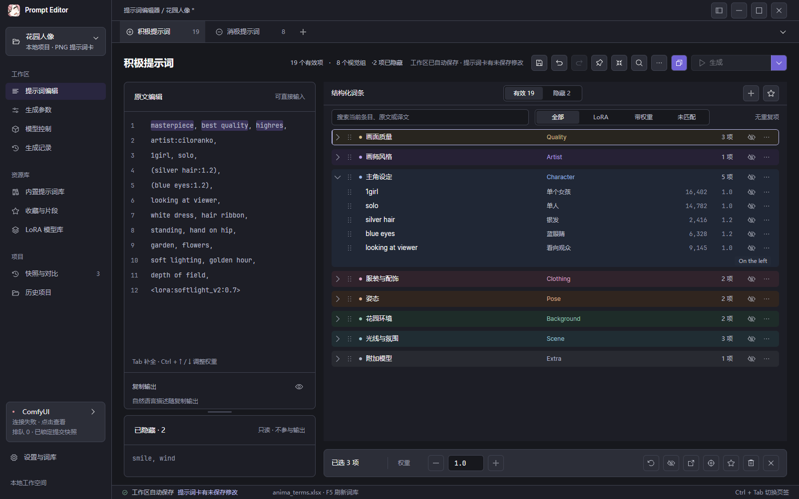
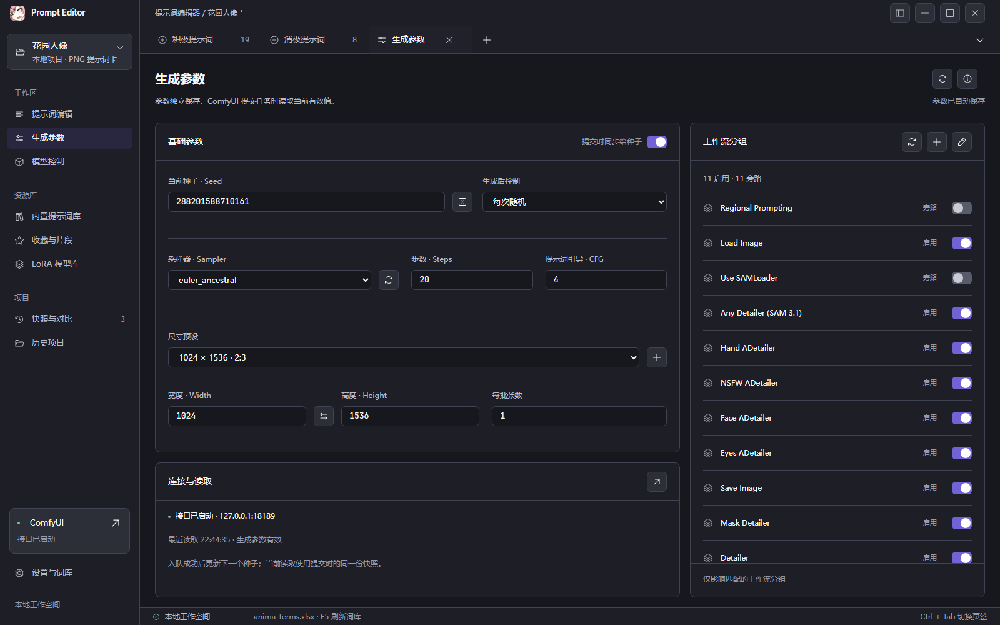
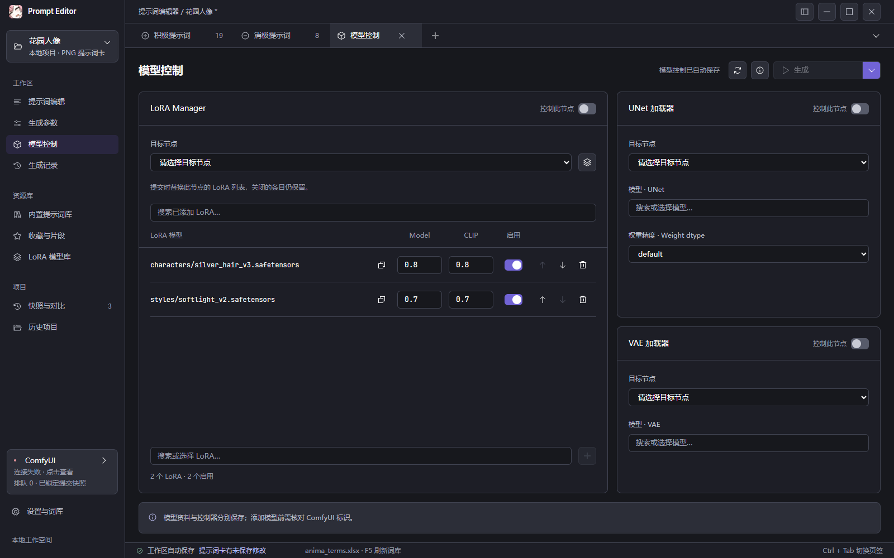
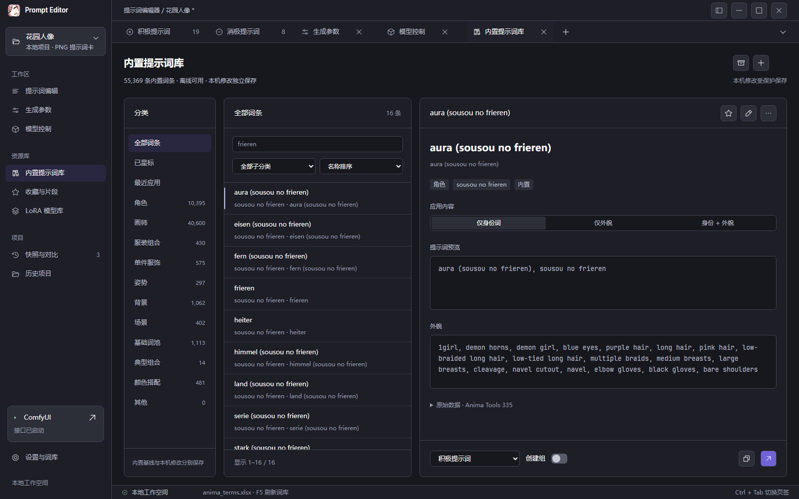
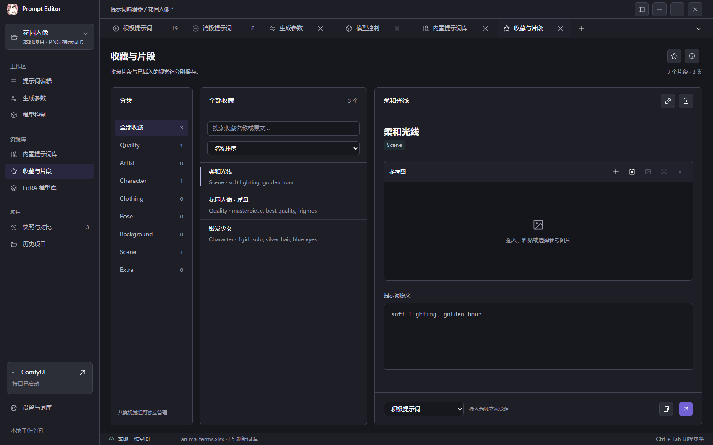
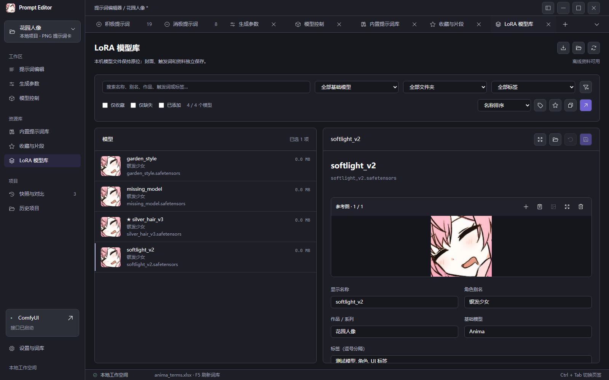
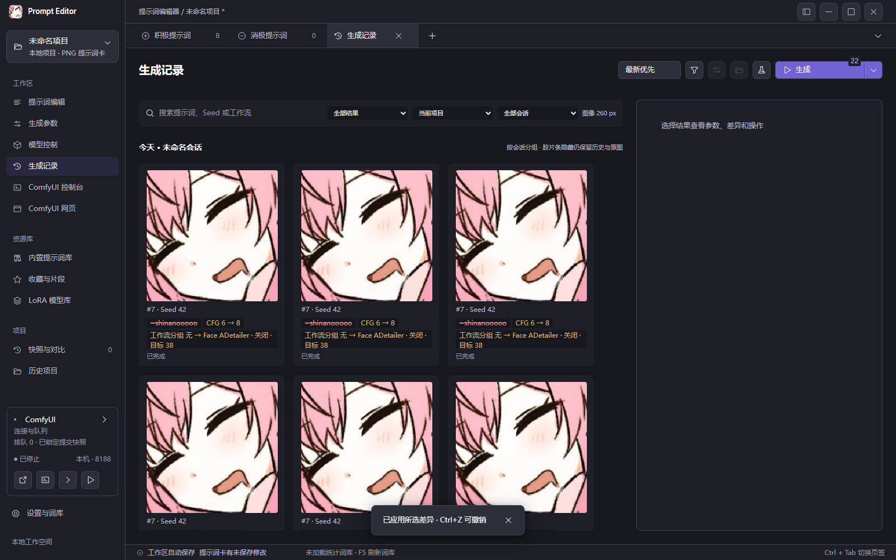
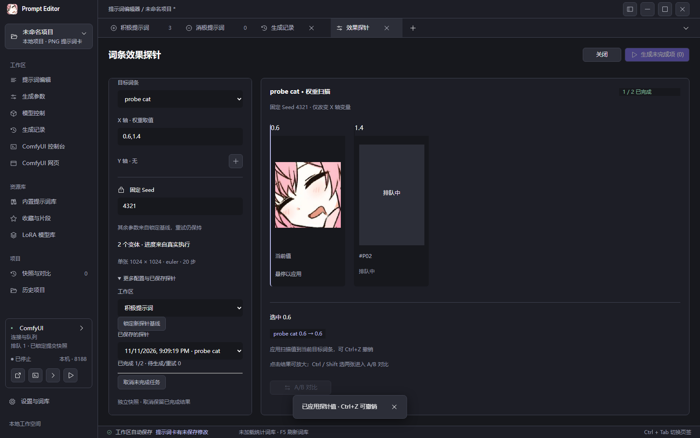
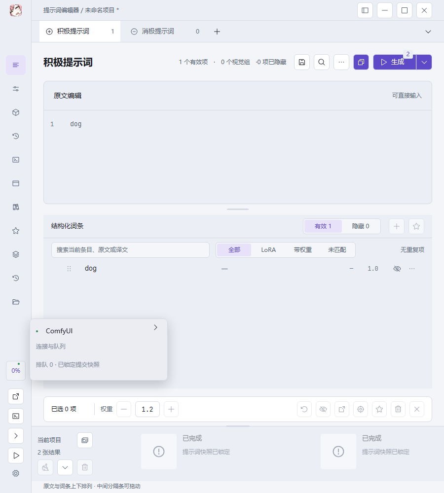

# Prompt Editor · 提示词编辑器

Windows 桌面提示词编辑与 ComfyUI 协同工具，基于 Tauri 2、Rust、React 和 TypeScript。支持深色 / 浅色主题，使用便携数据目录。



*截图使用示例数据，生成联动部分使用 mock 数据；个别界面细节可能与当前版本有所不同。*

## 下载与运行

在 [GitHub Releases](https://github.com/memo2586/PromatEditor/releases/latest) 下载 Windows x64 的 `PromptEditor.exe`，放到可写目录后运行。需要 Windows 10 / 11 x64 和 Microsoft Edge WebView2 Runtime；使用编译好的程序不需要安装 Node.js、Rust 或 Python。

程序默认在可执行文件同级的 `data/` 中保存设置、工作区和资源资料。升级前请备份并保留整个 `data/`。也可通过 `--data-dir <目录>` 指定位置。旧版 JSON 项目和 PNG 提示词卡可继续导入。

## 功能模块

| 模块 | 主要用途 |
| --- | --- |
| 提示词编辑 | 同步编辑原文和结构化词条，调整分组、顺序、权重与隐藏状态 |
| 查词与补全 | 搜索中英文词条，在光标处补全或从词库、收藏插入内容 |
| 生成参数与模型控制 | 设置 Seed、采样参数、工作流分组，以及 LoRA、UNet 和 VAE |
| 内置提示词库 | 分类检索、收藏和应用内置词条，维护本地修改 |
| 收藏与 LoRA 模型库 | 保存常用片段、参考图、模型资料、触发词与推荐权重 |
| 生成记录与胶片条 | 按项目和会话浏览图片，对比差异并复用历史参数 |
| 大图与效果探针 | 缩放查看、双图对比、固定 Seed 扫描词条权重或参数效果 |
| 项目与快照 | PNG 提示词卡、生成信息导入、命名快照、历史项目与撤销 / 重做 |
| ComfyUI 工作台与设置 | 控制台、网页标签页、外观、编辑习惯和便携数据管理 |

### 1. 提示词编辑与视觉分组

积极 / 消极提示词各自维护原文和结构化词条。直接修改文本即可同步解析，也可以在词条列表中操作。

- 支持括号权重、嵌套括号、多词共享权重、转义字符与 LoRA 声明等语法。
- 按画面质量、画师、角色、服装、姿态、背景、场景等类别组织视觉组；支持折叠、重命名、拖拽和自然语言描述。
- 单条或批量调整权重、隐藏、移动、收藏及删除；隐藏词条保留在项目中，不参与有效提示词输出。
- 工作区自动保存；PNG 项目卡的未保存修改单独提示，支持项目级撤销 / 重做。

### 2. 查词、原文补全与复制输出

在编辑时查找词条、译文、内置条目和收藏片段，减少反复切换页面。

- 原文光标附近提供补全，使用 Tab 接受、Esc 关闭；也可打开侧边查词抽屉。
- 可导入外部 Excel 统计词库，辅助查看词条译文和使用统计，使用 F5 刷新。
- 支持复制有效提示词，并根据视觉组描述整理输出格式。

### 3. 生成参数与工作流分组

集中设置 Seed、生成后 Seed 控制、采样器、步数、CFG、宽高和批次数。

- Seed 可固定、递增、递减或随机变化；尺寸支持预设、自定义和宽高互换。
- 从 ComfyUI 读取可用采样器和工作流分组，控制 Fast Groups Bypasser 对应分组的启用状态。
- 提交时锁定提示词和参数快照；随后继续编辑不会改变已提交任务的输入。

<details>
<summary>查看生成参数与工作流分组截图</summary>



</details>

### 4. LoRA、UNet 与 VAE 模型控制

按工作流节点选择控制目标，在编辑器中集中管理本次生成所用模型。

- LoRA 支持独立的 Model / CLIP 权重、启用开关、排序和模型搜索。
- 可从 LoRA 模型库把选中模型加入控制器，再核对工作流中的模型标识。
- 支持标准与 LoRA Manager 对应的 UNet 加载器，以及 VAE 加载器；各类控制可独立启用。

<details>
<summary>查看模型控制截图</summary>



</details>

### 5. 内置提示词库

内置约 55,369 条提示词，支持按分类、中英文名称和子分类查找。

- 提供全部、已星标和最近应用视图；可按身份词、外貌或两者组合应用到工作区。
- 支持选择积极 / 消极工作区，并按需创建视觉组。
- 支持新增、编辑、删除、恢复默认及导出 CSV；本地修改与内置基线分开保存。

<details>
<summary>查看内置提示词库截图</summary>



</details>

### 6. 收藏与片段

把常用角色、画风、构图或光照提示词保存为可复用片段。

- 按类别管理名称与提示词内容，搜索后可插入为独立视觉组。
- 支持多张参考图、封面切换和大图查看，可从文件或剪贴板添加图片。
- 收藏资料独立保存在数据目录中，可随便携数据一起迁移。

<details>
<summary>查看收藏与片段截图</summary>



</details>

### 7. LoRA 模型库

把本地模型文件与可检索的模型资料联系起来，方便选择模型与使用触发词。

- 可配置模型目录，或从 ComfyUI / 已安装的 LoRA Manager 读取可用模型与资料。
- 维护名称、角色别名、作品、基础模型、标签、触发词、推荐权重、链接和参考图。
- 支持名称与标签筛选、收藏、缺失模型筛选、多选批量操作，以及加入模型控制器。

<details>
<summary>查看 LoRA 模型库截图</summary>



</details>

### 8. 生成记录与当前项目胶片条

历史结果按项目和会话归档，适合找回之前的图片与生成参数。

- 按项目、会话和任务状态筛选，并搜索提示词、Seed、工作流或模型内容。项目和会话支持输入筛选，按最近记录从新到旧排列。
- 鼠标位于历史网格时，按 Ctrl + 滚轮调整图像大小，网格实时重排。
- 胶片条只展示当前项目，拖动上边缘改变高度；信息不足时垂直居中，高度充足时展示更多差异。
- 点击图片查看大图；点击 Seed 复制数值，点击积极提示词差异复制该图完整积极提示词，点击其他参数差异打开导入选择器。
- 右键差异区可原参数重跑、随机 Seed 重跑、保存快照后应用、确认后直接应用或删除记录。重跑不会覆盖当前项目，删除记录不会删除原图。

<details>
<summary>查看生成记录截图</summary>



</details>

### 9. 大图查看、参数差异与效果探针

从历史结果或胶片条打开图片，缩放、平移和切换结果，同时查看该图快照与当前编辑状态的差异。

- 差异涵盖积极 / 消极提示词、Seed、CFG、尺寸、工作流分组、LoRA 模型与权重、UNet 和 VAE 等。
- 可只导入选中的差异，或经过确认后完整应用；支持双图 A/B 对比。
- 效果探针固定 Seed 和基线，扫描词条权重等变量；支持 X / Y 轴配置、结果预览和应用选中的值。

<details>
<summary>查看大图参数差异与效果探针截图</summary>




</details>

### 10. PNG 项目卡、快照与历史项目

将一次创作过程保存下来，在不同参数方案之间继续编辑。

- PNG 提示词卡保存工作区、视觉组、快照与参数，并保留封面像素及已有 ComfyUI 元数据。
- 可从 ComfyUI PNG 生成信息中选择导入内容，也兼容旧版 JSON 项目。
- 命名快照保存并恢复提示词、组和成员归属、生成参数、模型设置与工作流映射；单纯的视觉组归属、组增删和组块顺序变化不作为差异项。
- 历史项目提供最近打开列表，便于重新打开项目文件；旧快照缺少参数字段时保留当前对应设置。

### 11. ComfyUI 控制台与网页

除了生成联动，也可在编辑器中管理本地 ComfyUI 进程和打开工作流页面。

- 独立控制台展示进程状态、运行日志，支持启动、停止、复制 / 清空日志、换行和自动滚动。
- ComfyUI 网页可在独立标签页或外部浏览器中打开，便于编辑工作流后返回提示词页面。
- 首次启动本地 ComfyUI 前，需在设置中指定实际安装目录、Python 路径和附加启动参数，并选择端口、局域网访问及退出处理方式。

### 12. 外观、编辑习惯与便携数据

深色 / 浅色主题、强调色、背景图和编辑偏好可按使用习惯调整。

- 背景图支持不透明度、模糊度与填充设置；可调整权重步长、视觉组收起和 LoRA 名称复制规则。
- 窄窗口自动调整布局，原文与词条可上下排列；也支持紧凑窗口与窗口置顶。
- 设置、收藏、模型资料和参考图保存在数据目录中，可备份、迁移或用启动参数指定位置。

<details>
<summary>查看浅色主题与窄窗口布局</summary>



</details>

## 推荐工作流

推荐使用这位作者维护的 [Anima Workflows](https://civitai.com/models/2426853/anima-workflows)，可与本工具配合使用。

请按作者页面说明获取工作流、模型和依赖，加载后再安装下方 Bridge，并在编辑器中读取、选择对应的模型节点和工作流分组。

## 连接 ComfyUI

1. 把 [`integrations/comfyui/ComfyUI-Prompt-Editor-Bridge`](integrations/comfyui/ComfyUI-Prompt-Editor-Bridge) 整个目录放进 ComfyUI 的 `custom_nodes/`。
2. 重启 ComfyUI，刷新浏览器并打开工作流，添加「提示词编辑器 · 提示词与参数」节点。
3. 启动编辑器，配置实际 ComfyUI 地址。ComfyUI 常用端口为 `8188`，编辑器本地 Bridge 默认端口为 `8189`。
4. 读取节点、模型和分组，选择控制目标后生成。更新时请整体替换 Bridge 目录，并同步更新编辑器。

生成联动需要 ComfyUI 服务和打开对应工作流的浏览器页面；提示词编辑、资源管理与项目保存可以独立使用。扩展细节见 [Bridge 使用说明](integrations/comfyui/ComfyUI-Prompt-Editor-Bridge/README.md)。

## 从源码构建

需要 Windows x64、Node.js、Rust、MSVC C++ 构建工具、Windows SDK 和 WebView2。

```powershell
git clone https://github.com/memo2586/PromatEditor.git
cd PromatEditor
npm ci
npm run tauri -- build --no-bundle
```

可执行文件位于 `src-tauri/target/release/prompt-editor-tauri.exe`。将其复制到自己的便携目录，可改名为 `PromptEditor.exe`。运行程序会创建数据目录。

开发模式：

```powershell
npm run tauri -- dev
```

开发前端使用 `1420` 端口，开发 RPC 使用 `1421`；发行版内嵌前端，不依赖开发服务器。

## 常用快捷键

| 快捷键 | 操作 |
| --- | --- |
| Ctrl+Enter | 提交生成 |
| Ctrl+↑ / Ctrl+↓ | 调整词条权重 |
| Ctrl+Z / Ctrl+Y | 撤销 / 重做 |
| Ctrl+S / Ctrl+Shift+S | 保存 / 另存为提示词卡 |
| Ctrl+Shift+C | 复制当前工作区有效提示词 |
| Ctrl+J | 折叠 / 展开胶片条 |
| Ctrl+滚轮 | 在生成记录网格中调整图像大小 |
| Tab / Esc | 接受 / 关闭原文补全 |
| F5 | 刷新外部统计词库 |

## 启动参数

| 参数 | 说明 |
| --- | --- |
| `--data-dir <目录>` / `--data <目录>` | 指定数据目录 |
| `--bridge-port <端口>` | 设置本地 Bridge 端口，默认 8189 |

## 源码结构

- `src/`：React 界面与交互。
- `src-tauri/`：Rust 应用、存储、解析、内置词库和运行资源。
- `public/`：图标与字体。
- `integrations/comfyui/`：ComfyUI 节点与浏览器扩展、连接检查和示例工作流。
- `docs/images/`：README 使用的功能演示截图。

本公开仓库保留产品源码、构建配置、必要资源和用户文档；设计源文件、开发验收记录及测试工程不包含在内。

## 许可证

代码使用 [MIT License](LICENSE)。字体的 OFL 许可证随文件保存在 [`public/fonts/`](public/fonts/)。
